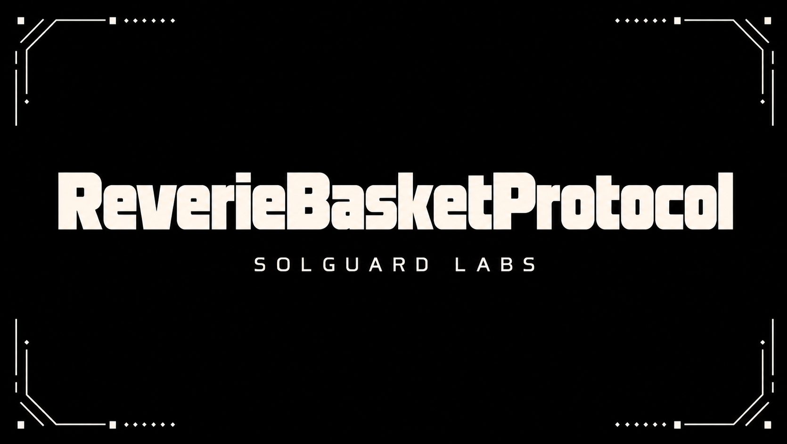
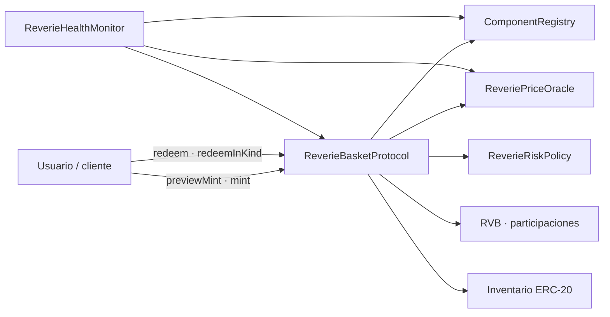
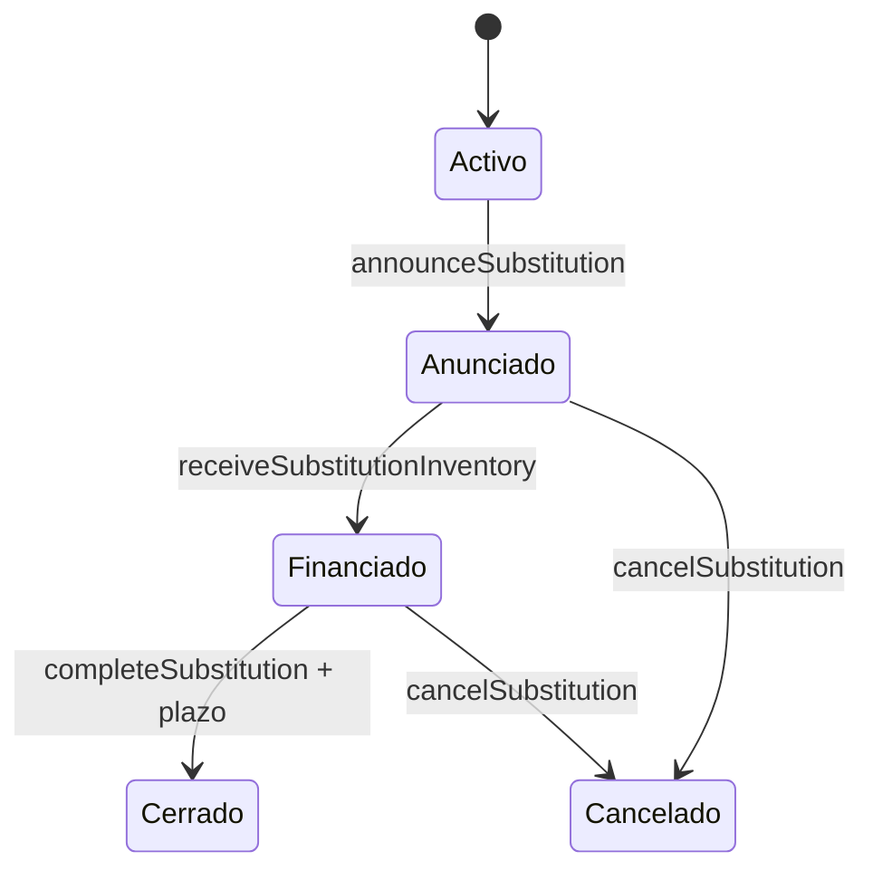

# Reverie Basket Protocol



Reverie gestiona una cesta tokenizada de componentes ERC-20. El usuario deposita los activos conforme a los pesos vigentes y recibe `RVB`; las participaciones permiten solicitar una redención proporcional o una selección de activos admitidos. Inventario, precios, políticas y operaciones programadas se gestionan en módulos separados.

## Arquitectura



El registro determina estado, pesos y límites de cada componente. El oráculo entrega precios con heartbeat. La política acota comisiones, desvíos y ventanas temporales. El vault ejecuta depósitos, redenciones, cosechas y cambios programados; los módulos de lectura sirven a operadores e integradores sin custodiar activos.

## Modelo económico

Para una emisión nominal `B` y componente activo `i` de peso `w_i` en puntos básicos, el depósito objetivo se valora como `V_i = B × w_i / 10 000`. La cantidad de tokens depende de `V_i`, del precio del oráculo y de los decimales del activo. `previewMint` expone las cantidades concretas antes de aprobar o enviar la transacción. Una redención proporcional distribuye el inventario activo según las participaciones quemadas y el suministro total de `RVB`.

La sustitución de un componente es una operación programada: anuncio, recepción de inventario sustituto, espera mínima y cierre. Las consultas `navReport`, `componentValues` y `substitutionReadiness` ofrecen distintas vistas para seguimiento operativo; no reemplazan una política externa de ejecución ni una valoración independiente.



## Uso local

Requiere Bun `1.3.14`. Los tests usan una red Hardhat local y tokens simulados. No se suministra configuración de despliegue público.

```bash
bun install --frozen-lockfile
bun run build
bun run typecheck
bun run test
bash scripts/ci.sh
```

El cliente de solo lectura `ReverieDepositClient` consulta `previewMint` y calcula por activo saldo, allowance y faltante. Ejemplo para una instancia de vault ya conectada:

```ts
const client = new ReverieDepositClient(vault);
const plan = await client.plan(ethers.parseEther("1000"), owner, receiver);
if (!plan.ready) console.table(plan.requirements);
```

`plan` no envía transacciones. El integrador debe verificar dirección de contrato, cadena, vigencia del precio y cambios de estado entre cotización y ejecución.

## Estructura y documentación

| Ruta                                   | Responsabilidad                                 |
| -------------------------------------- | ----------------------------------------------- |
| `src/vault`, `src/token`               | Custodia de componentes y suministro RVB        |
| `src/core`, `src/oracle`, `src/policy` | Configuración, precios y límites                |
| `src/modules`, `src/lens`              | Planificación, seguimiento y vistas             |
| `client/`                              | Preparación de depósitos para integraciones     |
| `test/`                                | Flujos funcionales y contratos de interfaz      |
| `docs/`                                | Arquitectura, economía, integración y operación |

Consultar [arquitectura](./docs/arquitectura.md), [modelo económico](./docs/modelo-economico.md), [integración](./docs/integracion.md) y [operación](./docs/operacion.md). La política de seguridad y los supuestos están en [SECURITY.md](./SECURITY.md).

## Entrega

La versión `v1.0.0` identifica el estado versionado de este repositorio. `main`, `production` y el tag estable se verifican mediante CI de integridad. Esa denominación no acredita un despliegue en una red pública ni custodia de activos externos.

Licencia MIT.
