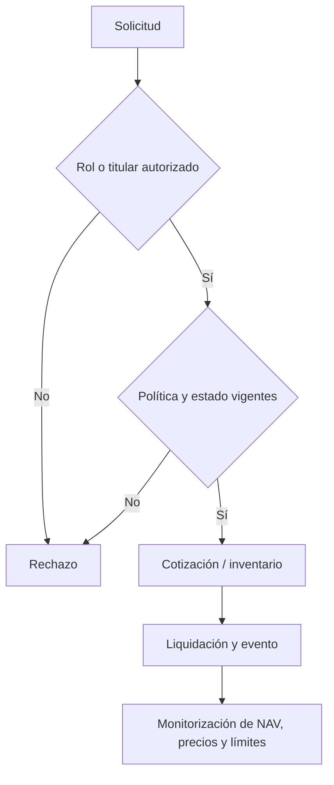

# Política de seguridad

## Alcance

La revisión de seguridad incluye vault, token RVB, registro de componentes, oráculo, política de riesgo, bibliotecas matemáticas, módulos de planificación y clientes de consulta. Los mocks y fixtures verifican comportamiento local; no representan activos externos.

## Supuestos de confianza

- Los componentes son ERC-20 estándar: no se admiten tokens con rebase ni comisión en transferencias.
- Administración de roles, precios y operación del keeper son responsabilidades independientes. Su separación efectiva depende de las direcciones configuradas en cada entorno.
- Las cotizaciones son instantáneas; un integrador debe controlar estado y precio antes de ejecutar.
- Una operación programada puede quedar pendiente, expirar o cancelarse. Los sistemas externos no deben inferir ejecución a partir del anuncio.

## Controles verificables

Los contratos separan autorización por rol, validación de parámetros, ventanas de ejecución, reentrancia en rutas de liquidación y consultas de frescura del oráculo. La suite automatizada cubre depósitos, redenciones, cosecha, cambio de pesos, sustitución y preparación de depósito. `bun run typecheck` valida el cliente TypeScript; `bash scripts/ci.sh` reproduce el gate.

## Invariantes operativas

- Una emisión requiere la cesta de depósitos cotizada para los pesos activos.
- Una redención quema las participaciones antes de transferir los activos calculados.
- Un cambio de peso o sustitución requiere estado y plazo adecuados.
- Los precios utilizados por los flujos que los requieren deben cumplir el heartbeat configurado.
- Toda diferencia entre valoración contable e inventario físico debe investigarse con contexto temporal, no resolverse automáticamente con una cotización aislada.

## Dependencias y reporte

Dependabot revisa dependencias npm y GitHub Actions. Antes de incorporar una actualización se ejecutan compilación, tipos, tests y revisión de diferencias. Para comunicar un problema, usar un canal privado con versión/commit, precondiciones, secuencia reproducible, resultado observado, resultado esperado e impacto cuantificado. No publicar datos sensibles ni transacciones de terceros en un issue público.
