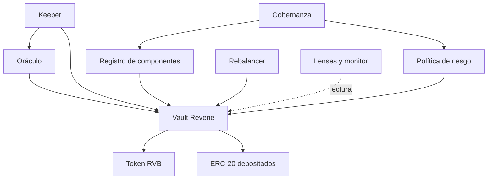

# Arquitectura de Reverie

El vault es el único punto que emite o quema `RVB` y custodia inventario. Gobernanza configura parámetros estructurales, rebalancer gestiona cambios de componentes, keeper reporta ingresos y risk manager establece umbrales. El registro, oráculo y política son contratos separados para hacer explícita la dependencia de cada operación.

`ComponentRegistry` conserva estado, decimales, pesos y límites. `ReveriePriceOracle` aplica rangos y antigüedad máxima. `ReverieRiskPolicy` contiene límites de comisión, desvío y plazos. `ReverieHealthMonitor` entrega un resumen de NAV, precios y pesos observados. Las vistas no autorizan una operación: describen el estado en el bloque consultado.

Un integrador debe registrar dirección de cada contrato, chain ID, bloque y timestamp de la lectura. Antes de firmar, reconsultar si cambia el bloque o vence el heartbeat.
