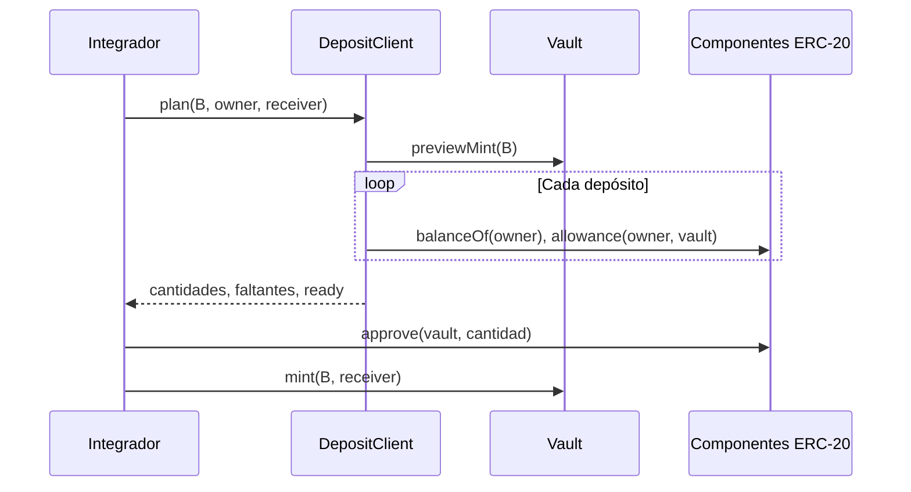

# Integración de clientes

El depósito empieza en `previewMint(B)` y termina en `mint(B, receiver)` tras aprobar cada componente. `ReverieDepositClient.plan` añade comprobación local de saldo y allowance por token; no firma ni emite transacciones.

Ejemplo: con `B = 1 000 RVB` y pesos 50/50, el plan devuelve `500 USDC` y `0,25 WETH` para el fixture. Si el usuario tiene `400 USDC`, el faltante de saldo es `100 USDC`; una aprobación alta no cubre ese déficit. Si tiene saldo pero allowance cero, el faltante de aprobación es la cantidad total.

Errores esperables: dirección inválida, B cero, precio vencido, allowance insuficiente, saldo insuficiente o cambio de configuración entre lectura y transacción. Capturar el error del contrato y volver a cotizar; no reintentar a ciegas una orden firmada con estado obsoleto.
