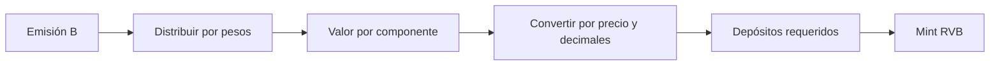

# Modelo económico y unidades

Los pesos se expresan en puntos básicos (`10 000 = 100 %`). El valor monetario usa escala de 18 decimales; la cantidad nativa de cada token usa sus decimales declarados. Si `B = 1 000 RVB`, USDC y WETH pesan `5 000 bps`, y WETH vale `2 000` unidades monetarias, la cotización de depósito es `500 USDC + 0,25 WETH`. Precio y pesos deben consultarse del estado actual, no fijarse en la interfaz.

La valoración bruta suma `balance_i × price_i` ajustado por decimales. Las métricas contables pueden utilizar conjuntos de componentes distintos durante cambios programados; por ello, el panel operativo debe identificar la fase de cada componente junto con la cifra de NAV. No se debe interpretar un valor aislado como liquidación garantizada.

La redención proporcional de un componente activo sigue `inventario_i × participaciones / suministro`. Los redondeos enteros pueden dejar polvo residual. Los tests comparan resultados exactos para el fixture: tras depositar `1 000 RVB`, la redención proporcional de `100 RVB` retorna `50 USDC` y `0,025 WETH`.

La cosecha registra bruto, comisión y neto. Con comisión de `100 bps` sobre `1 WETH`, `0,01 WETH` va a tesorería y `0,99 WETH` al vault. Reconciliar evento, variación de saldo y recibo del keeper.
