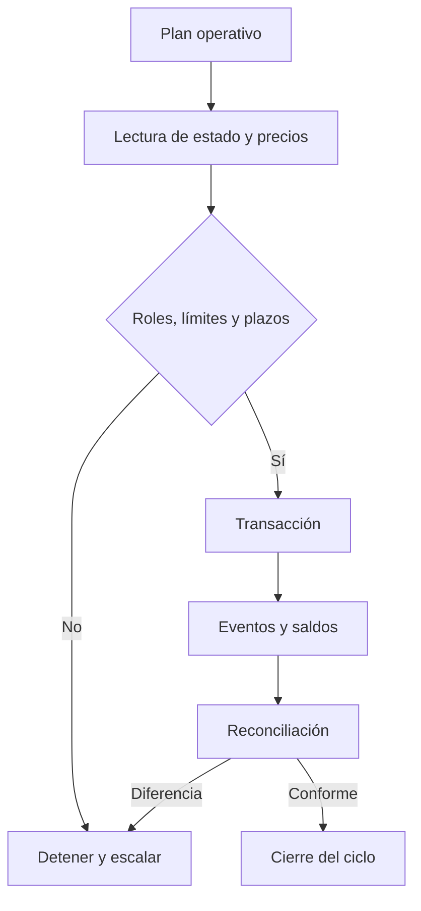

# Operación y observabilidad

Antes de una cosecha o sustitución, el operador consulta `protocolHealth`, `componentHealth` y el estado de la programación. Compara precios, pesos, caps e inventario contra el bloque de referencia. Los eventos se almacenan con hash de transacción y número de bloque para reconciliar el resultado.

Para una sustitución, registrar activo saliente, entrante, hash del memorando, hora de anuncio, plazo ejecutable, valor requerido y valor recibido. Verificar que el inventario de reemplazo cumple el umbral vigente. Tras el cierre, comprobar estados del registro y pesos activos.

Ante precio vencido, cap superado, desvío excesivo o pausa, detener automatismos y conservar evidencia de bloque, lectura y evento. Una alerta no justifica por sí sola cambiar parámetros de riesgo. Las decisiones de gobierno requieren revisión independiente y trazabilidad.
